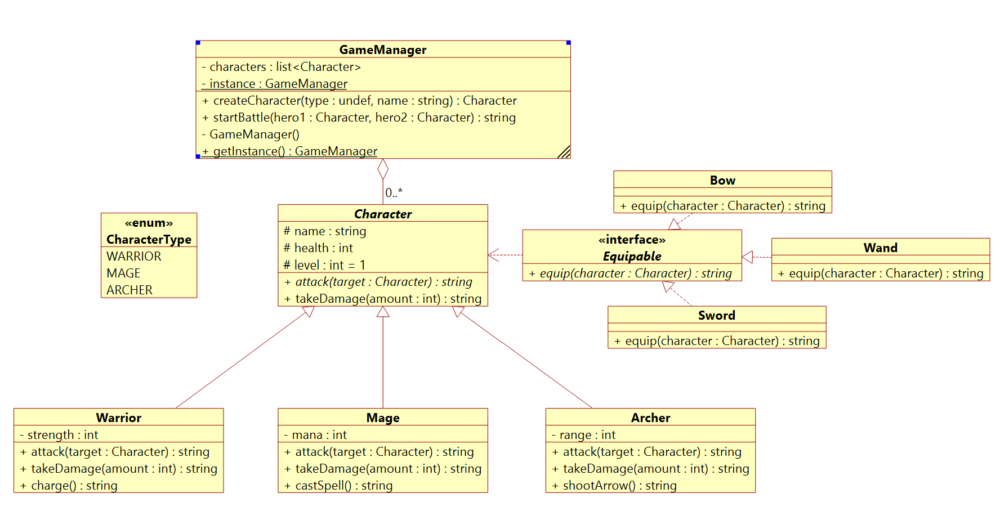

# Gestion de Personnages — POO (Java)

## Diagramme UML

## Contexte
Système de gestion de héros en Java orienté objet. Il permet de créer des personnages uniques, de gérer leurs équipements et d'organiser des combats.

## Architecture
* **`Character` (classe abstraite)** : modèle commun (`name`, `health`, `level`) avec les méthodes `attack(target)` et `takeDamage(amount)`.
* **Classes de héros** (héritent de `Character`) :
  * `Warrior` : `strength` et `charge()`
  * `Mage` : `mana` et `castSpell()`
  * `Archer` : `range` et `shootArrow()`
* **Équipements (`Equipable`)** : interface avec la méthode `equip(character)` pour booster les statistiques des héros (épée, baguette, arc).
* **`GameManager` (Singleton)** : gère la liste `characters`, la création (`createCharacter()`) et les affrontements (`startBattle()`).

## Livrables
* Simulation complète : création de héros, équipement d'objets et combat entre deux personnages.